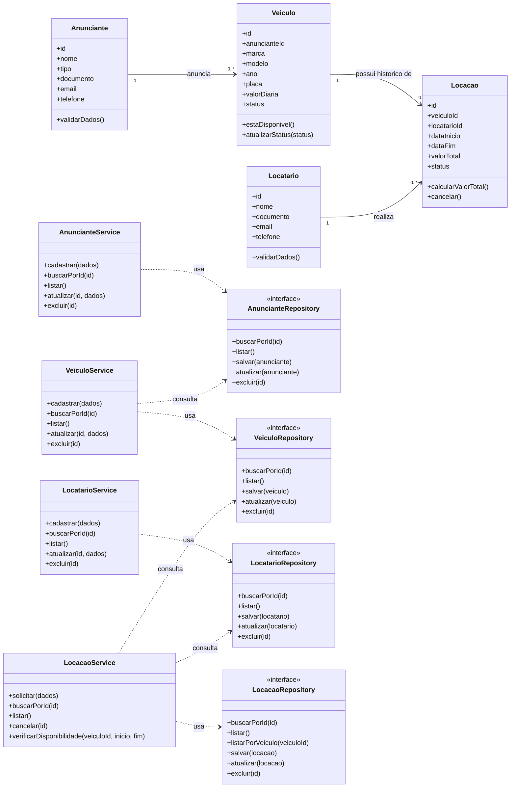

# Modelagem — Projeto 1

**Aluno(a):** Paulo Cézar Silva de Araújo

**Domínio:** Marketplace de aluguel de veículos

## 1. O domínio

É uma plataforma digital que permite que pessoas físicas e empresas anunciem seus próprios veículos para aluguel. Os interessados podem consultar os veículos disponíveis e realizar locações por períodos determinados.

O sistema permite o gerenciamento dos anunciantes, dos veículos cadastrados, dos locatários e das locações realizadas, mantendo as informações organizadas e verificando a disponibilidade dos veículos.

## 2. Entidades

| Entidade   | Atributos                                                           | Relacionamentos                                                                         |
| ---------- | ------------------------------------------------------------------- | --------------------------------------------------------------------------------------- |
| Anunciante | id, nome, tipo, documento, email, telefone                          | Pode cadastrar vários veículos.                                                       |
| Veiculo    | id, anuncianteId, marca, modelo, ano, placa, valorDiaria, status    | Pertence a um anunciante e pode estar associado a várias locações ao longo do tempo. |
| Locatario  | id, nome, documento, email, telefone                                | Pode realizar várias locações.                                                       |
| Locacao    | id, veiculoId, locatarioId, dataInicio, dataFim, valorTotal, status | Está associada a um veículo e a um locatário.                                        |

* **Anunciante:** representa a pessoa física ou empresa responsável por disponibilizar veículos para aluguel. O atributo `tipo` identifica se o anunciante é uma pessoa física ou uma empresa.
* **Veiculo:** representa os veículos cadastrados na plataforma, contendo suas características, valor da diária e situação de disponibilidade.
* **Locatario:** representa a pessoa interessada em alugar um veículo, armazenando suas informações pessoais e de contato.
* **Locacao:** registra o aluguel de um veículo, identificando o locatário, o veículo escolhido, o período da locação, o valor total e sua situação.

### Relacionamentos

* Um anunciante pode cadastrar vários veículos, mas cada veículo pertence a apenas um anunciante.
* Um veículo pode estar associado a várias locações ao longo do tempo, desde que não existam conflitos entre os períodos.
* Um locatário pode realizar várias locações, mas cada locação pertence a apenas um locatário.
* Cada locação está associada a um único veículo e a um único locatário.

## 3. Diagrama de classes

## 4. Responsabilidades

| Classe               | Papel                                                                                                       | Único motivo para mudar                                        |
| -------------------- | ----------------------------------------------------------------------------------------------------------- | --------------------------------------------------------------- |
| Anunciante           | Representar os dados e as regras próprias de quem anuncia veículos.                                       | Mudanças nas características ou regras do anunciante.         |
| Veiculo              | Representar os dados e as regras próprias dos veículos.                                                   | Mudanças nas características ou regras dos veículos.         |
| Locatario            | Representar os dados e as regras próprias de quem realiza locações.                                      | Mudanças nas características ou regras do locatário.         |
| Locacao              | Representar uma locação e suas regras próprias, como cálculo do valor total e cancelamento.             | Mudanças nas regras de uma locação.                          |
| AnuncianteService    | Coordenar as operações de cadastro, consulta, atualização e exclusão de anunciantes.                   | Mudanças nas regras do gerenciamento de anunciantes.           |
| VeiculoService       | Coordenar o gerenciamento dos veículos e verificar a existência do anunciante responsável pelo cadastro. | Mudanças nas regras do gerenciamento de veículos.             |
| LocatarioService     | Coordenar as operações de cadastro, consulta, atualização e exclusão de locatários.                   | Mudanças nas regras do gerenciamento de locatários.           |
| LocacaoService       | Coordenar as solicitações de locação e verificar a disponibilidade do veículo no período solicitado.  | Mudanças nas regras do processo de locação.                  |
| AnuncianteRepository | Definir as operações de acesso e persistência dos dados dos anunciantes.                                 | Mudanças na forma de armazenamento e consulta dos anunciantes. |
| VeiculoRepository    | Definir as operações de acesso e persistência dos dados dos veículos.                                   | Mudanças na forma de armazenamento e consulta dos veículos.   |
| LocatarioRepository  | Definir as operações de acesso e persistência dos dados dos locatários.                                 | Mudanças na forma de armazenamento e consulta dos locatários. |
| LocacaoRepository    | Definir as operações de acesso e persistência dos dados das locações.                                  | Mudanças na forma de armazenamento e consulta das locações.  |

## 5. Onde apliquei SRP e DIP

**SRP — Princípio da Responsabilidade Única:** cada classe possui uma responsabilidade específica. As entidades representam os conceitos do domínio e concentram suas próprias regras; os services coordenam os processos de negócio; e os repositories definem as operações de acesso aos dados. Dessa forma, nenhuma entidade salva a si mesma ou assume a responsabilidade de gerenciar todo o processo de locação.

**DIP — Princípio da Inversão de Dependência:** os services dependem dos contratos dos repositories, e não de uma implementação concreta de banco de dados. Assim, o sistema poderá utilizar SQLite com SQL puro posteriormente, sem que as regras de negócio precisem conhecer os detalhes da persistência. No diagrama, as dependências dos services apontam para os contratos dos repositories, nunca diretamente para o banco de dados.

## 6. Fora do escopo (YAGNI)

Nesta etapa do projeto, o desenvolvimento será concentrado nas funcionalidades essenciais para o funcionamento: o gerenciamento de anunciantes, o cadastro e a consulta de veículos e o gerenciamento de locações. Funcionalidades adicionais, como autenticação de usuários, processamento de pagamentos, cálculo de comissões, avaliações, notificações e geração de relatórios, não serão implementadas neste momento. Essa decisão segue o princípio YAGNI ( *You Aren’t Gonna Need It* ), evitando a inclusão de recursos que não são necessários para atender aos objetivos atuais do projeto e mantendo a modelagem simples, organizada e preparada para futuras evoluções.
