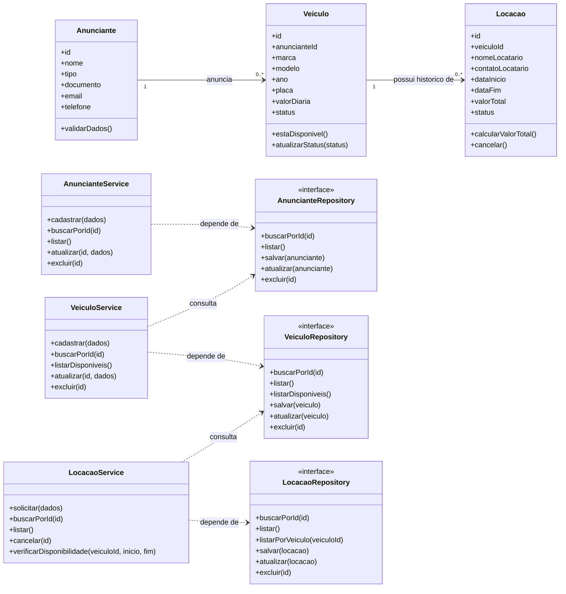

# Modelagem — Projeto 1

**Aluno(a):** Paulo Cézar Silva de Araújo

**Domínio:** Marketplace de aluguel de veículos

## 1. O domínio

É uma plataforma digital que permite que pessoas físicas e empresas anunciem seus próprios veículos para aluguel. Os interessados podem consultar os veículos disponíveis e realizar locações por um período determinado.

O sistema controla os anunciantes, os veículos cadastrados e as locações, garantindo que um veículo não tenha duas locações com períodos conflitantes.

## 2. Entidades

| Entidade   | Atributos                                                                               | Relacionamentos                                                                   |
| ---------- | --------------------------------------------------------------------------------------- | --------------------------------------------------------------------------------- |
| Anunciante | id, nome, tipo, documento, email, telefone                                              | Pode cadastrar vários veículos.                                                 |
| Veiculo    | id, anuncianteId, marca, modelo, ano, placa, valorDiaria, status                        | Pertence a um anunciante e pode aparecer em várias locações ao longo do tempo. |
| Locacao    | id, veiculoId, nomeLocatario, contatoLocatario, dataInicio, dataFim, valorTotal, status | Está associada a um veículo.                                                    |

O atributo `tipo` do anunciante pode assumir os valores `PESSOA_FISICA` ou `EMPRESA`. O atributo `status` do veículo indica se ele está disponível para locação ou inativo. Já o status da locação pode ser `SOLICITADA`, `APROVADA`, `CONCLUIDA` ou `CANCELADA`.

## 3. Diagrama de classes

As interfaces `AnuncianteRepository`, `VeiculoRepository` e `LocacaoRepository` representam contratos de acesso aos dados. As implementações concretas desses contratos serão definidas posteriormente, quando o projeto começar a ser programado.

## 4. Responsabilidades

| Classe               | Responsabilidade                                                                                           | Motivo para mudar                                        |
| -------------------- | ---------------------------------------------------------------------------------------------------------- | -------------------------------------------------------- |
| Anunciante           | Representar quem anuncia os veículos e validar suas informações.                                        | Mudanças nas regras e nos dados do anunciante.          |
| Veiculo              | Representar o veículo e suas regras próprias, como disponibilidade e valor diário válido.              | Mudanças nas regras do veículo.                        |
| Locacao              | Representar uma locação e calcular seu valor total com base no período e na diária informada.          | Mudanças nas regras próprias da locação.             |
| AnuncianteService    | Coordenar o cadastro, a consulta, a atualização e a exclusão de anunciantes.                            | Mudanças no processo de gerenciamento de anunciantes.   |
| VeiculoService       | Coordenar o cadastro e o gerenciamento dos veículos, verificando a existência do anunciante.             | Mudanças no processo de gerenciamento de veículos.     |
| LocacaoService       | Coordenar as solicitações de locação e verificar a disponibilidade do veículo no período solicitado. | Mudanças nas regras do processo de locação.           |
| AnuncianteRepository | Definir as operações de persistência dos anunciantes.                                                   | Mudanças na forma de consultar e armazenar anunciantes. |
| VeiculoRepository    | Definir as operações de persistência dos veículos.                                                     | Mudanças na forma de consultar e armazenar veículos.   |
| LocacaoRepository    | Definir as operações de persistência das locações.                                                    | Mudanças na forma de consultar e armazenar locações.  |

## 5. Onde apliquei SRP e DIP

**SRP — Princípio da Responsabilidade Única:** cada classe possui uma responsabilidade específica. As entidades representam os conceitos do domínio e concentram suas próprias regras; os services coordenam os processos de negócio; e os repositories definem as operações de acesso aos dados. Dessa forma, nenhuma entidade salva a si mesma ou assume a responsabilidade de gerenciar todo o processo de locação.

**DIP — Princípio da Inversão de Dependência:** os services dependem dos contratos dos repositories, e não de uma implementação concreta de banco de dados. Assim, o sistema poderá utilizar SQLite com SQL puro posteriormente, sem que as regras de negócio precisem conhecer os detalhes da persistência. No diagrama, as dependências dos services apontam para os contratos dos repositories, nunca diretamente para o banco de dados.

## 6. Fora do escopo (YAGNI)

Nesta etapa do projeto, o desenvolvimento será concentrado nas funcionalidades essenciais para o funcionamento: o gerenciamento de anunciantes, o cadastro e a consulta de veículos e o gerenciamento de locações. Funcionalidades adicionais, como autenticação de usuários, processamento de pagamentos, cálculo de comissões, avaliações, notificações e geração de relatórios, não serão implementadas neste momento. Essa decisão segue o princípio YAGNI ( *You Aren’t Gonna Need It* ), evitando a inclusão de recursos que não são necessários para atender aos objetivos atuais do projeto e mantendo a modelagem simples, organizada e preparada para futuras evoluções.
